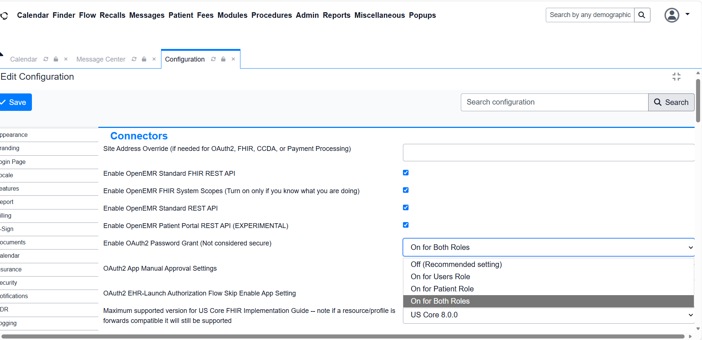
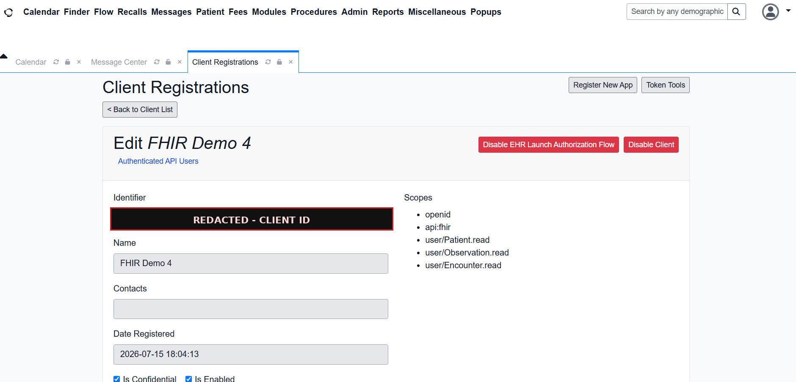
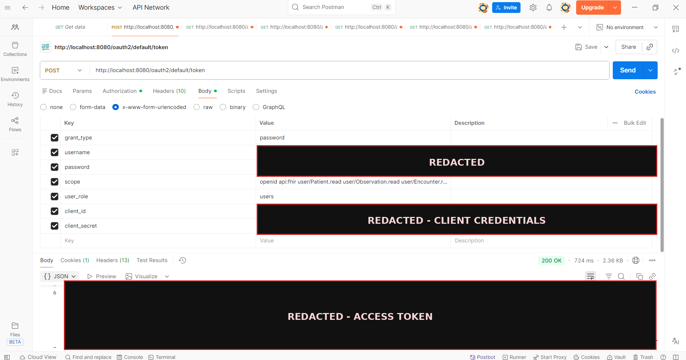
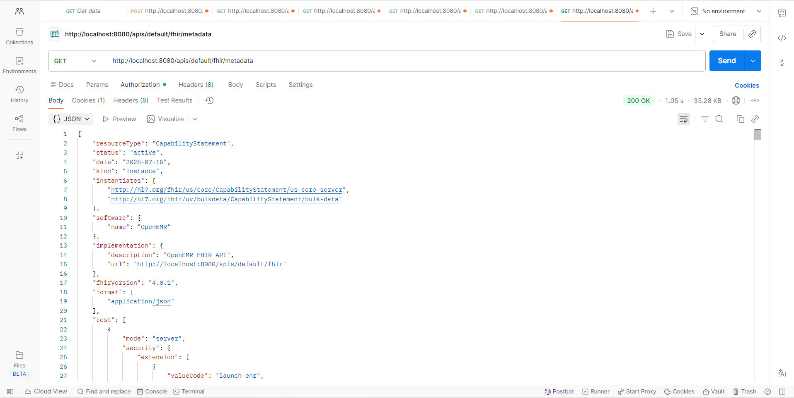
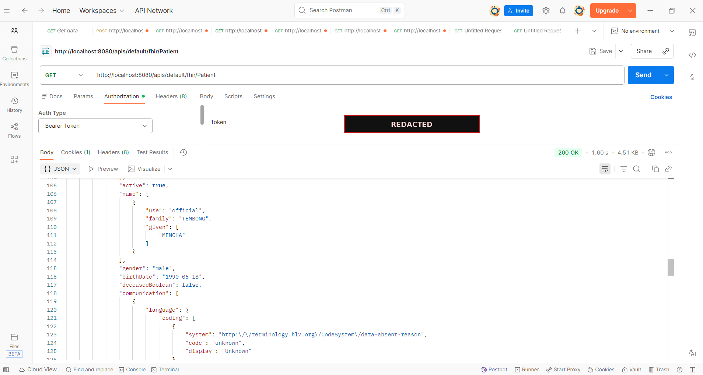
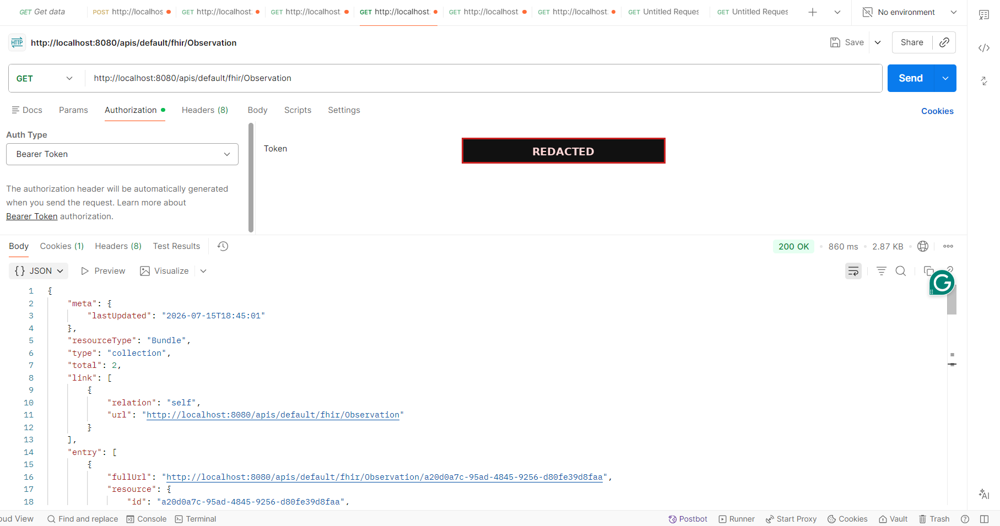
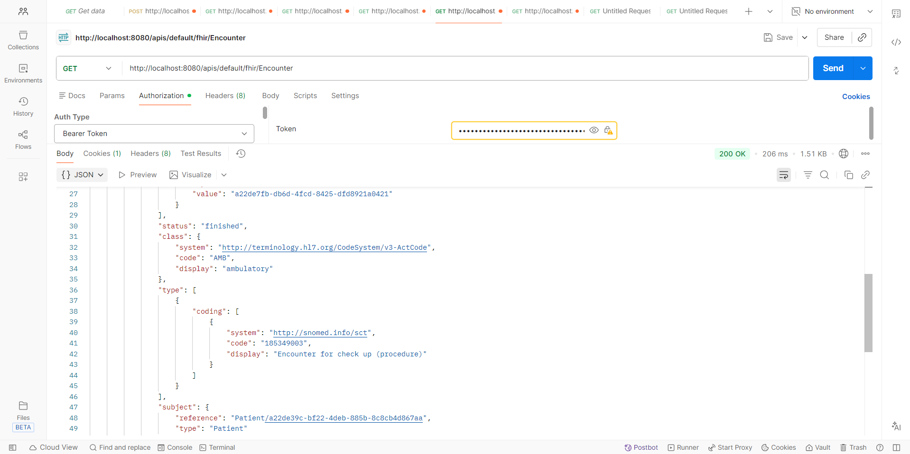

# 2 · Enabling and securing the FHIR R4 API

OpenEMR ships with a FHIR R4 interface, but it arrives switched off. Turning it
on is four steps, and three of them are about authorization rather than FHIR.

## Step 1 · Turn the connectors on

`Administration → Globals → Connectors`



The settings that matter:

| Setting | Why |
|---|---|
| Enable OpenEMR Standard FHIR REST API | The FHIR endpoints themselves |
| Enable OpenEMR FHIR System Scopes | Allows `system/` scopes for backend clients |
| Enable OpenEMR Standard REST API | OpenEMR's own non-FHIR API |
| Enable OpenEMR Patient Portal REST API | Portal-side access |
| Site Address Override | Must be set, or OAuth2 builds the wrong redirect URLs |

That last one is easy to miss and causes failures that look like authorization
bugs. The token endpoint returns URLs built from the configured site address, so
if it is blank or wrong, the client is sent somewhere that does not answer.

The instance was also pinned to **US Core 8.0.0** as the maximum supported
implementation guide version, which is visible in the connector settings.

## Step 2 · Register a client

`Administration → System → API Clients → Register New App`



Registration returns a client ID and a client secret. The secret is shown once
and cannot be retrieved afterwards, so it goes into a password manager at that
moment or it is gone and the client has to be registered again.

A newly registered client is **disabled by default**. It has to be explicitly
enabled before it will issue tokens, and the failure mode if you forget is an
authorization error that gives no hint about the cause.

### Scopes

The client was granted read-only access to exactly the resources needed:

```
openid
api:fhir
user/Patient.read
user/Observation.read
user/Encounter.read
```

Scopes follow a `context/Resource.action` pattern. `user/Patient.read` means
"acting as a user, read Patient resources". There is no write scope in that
list, which is deliberate: the client's job was to retrieve clinical data and
prove it could be read in a standard shape, not to modify records.

## Step 3 · Get a token



`POST /oauth2/default/token` returning `200 OK` with an access token.

A note on the grant type. The request above uses the **password grant**, which
OpenEMR itself labels "not considered secure" in its own settings screen. It was
enabled for demonstration because it makes the exchange legible in a live
walkthrough: you can see the credentials go in and the token come back in a
single request.

In a real clinic that grant stays off. Production SMART on FHIR uses the
authorization code flow, where the user authenticates against the EMR directly
and the client never handles their password. Demonstrating the simple case and
knowing why it is the wrong one are not the same thing, and the distinction is
worth stating out loud rather than quietly shipping the insecure version.

## Step 4 · Query

The capability statement needs no authentication and is the fastest way to prove
the API is alive:

```http
GET /apis/default/fhir/metadata
```



Everything else needs the bearer token:

```http
GET /apis/default/fhir/Patient
GET /apis/default/fhir/Observation
GET /apis/default/fhir/Encounter
GET /apis/default/fhir/DiagnosticReport
Authorization: Bearer <token>
```

| | |
|---|---|
|  |  |

Encounters come back with SNOMED CT coding on the visit type and an HL7
`v3-ActCode` class:

```json
"class": { "system": "http://terminology.hl7.org/CodeSystem/v3-ActCode",
           "code": "AMB", "display": "ambulatory" },
"type":  [{ "coding": [{ "system": "http://snomed.info/sct",
                         "code": "185349003",
                         "display": "Encounter for check up (procedure)" }] }]
```



## What the server advertises

From the capability statement, the hosted instance supported read and search on:

`AllergyIntolerance` · `Appointment` · `CarePlan` · `CareTeam` · `Condition` ·
`Coverage` · `Device` · `DiagnosticReport` · `DocumentReference` · `Binary` ·
`Encounter` · `Goal` · `Group` · `Immunization` · `Location` · `Medication` ·
`MedicationRequest` · `Observation` · `Organization` · `Patient` · `Person` ·
`Practitioner` · `PractitionerRole` · `Procedure` · `Provenance`

Plus bulk export via `$export` at system, group and patient level.

Security is declared as SMART on FHIR with OpenID Connect, confidential
symmetric clients, and both EHR-launch and standalone launch contexts.

## What tripped me up

**The client is disabled on creation.** Registering it is not enough.

**Site Address Override being blank** produces authorization failures that look
like credential problems.

**Scopes are granted at registration.** Asking for a scope at token time that
the client was never granted fails, and the error does not name the scope.

**An empty result is not a broken endpoint.** `GET /Observation` returning zero
entries usually means no structured results exist for that patient yet, not that
the API is misconfigured. Chasing that as a bug wastes time that belongs on
getting data into the chart first.

---

Next: [Terminology →](03-terminology-loinc-icd10.md)
