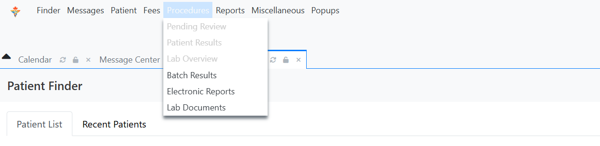

# 4 · Building a working laboratory order

Loading LOINC into the code list does not give you an orderable test. The code
sits in a lookup table; a physician opening an encounter still has nothing to
click. Turning a code into something a clinician can order, and a technician can
result, is a separate configuration job.

That gap took me longer to find than it should have, and it is the single most
useful thing I learned about how OpenEMR handles laboratories.

## The pieces

```
Procedure catalogue entry          "Hemoglobin A1c", LOINC 4548-4
        │                           units: %, reference range: < 5.7
        ▼
Procedure order                    placed from a patient encounter
        │                           carries diagnosis E11.9 and ordering provider
        ▼
Sending facility                   the laboratory the order is addressed to
        │
        ▼
Procedure result                   value 7.8, flagged High, status Final
        │
        ▼
FHIR Observation + DiagnosticReport
```

Each arrow is a place the chain can break, and a code that is correct in the
catalogue but missing from the result is a silent failure.

## Configuring the test

`Procedures → Configuration`

The catalogue entry carries:

| Field | Value |
|---|---|
| Procedure name | Hemoglobin A1c |
| Code type | LOINC |
| Code | `4548-4` |
| Units | % |
| Reference range | < 5.7 |

Units and reference range are not decoration. The range is what drives the
abnormal flag on the result, and the flag is what a physician scanning a chart
actually reads. A result of 7.8 with no range attached is a number. A result of
7.8 flagged High against a range of < 5.7 is a finding.

## Placing an order

A procedure order is created from inside a patient encounter, not from a
standalone menu. This caught me out early: the lab menu items under
`Procedures` sit greyed out until a patient chart is open.



Pending Review, Patient Results and Lab Overview only become available once a
patient is loaded. There is no error message explaining this, and the obvious
reading of a greyed-out menu is that permissions are wrong rather than that
context is missing.

The order itself carries:

- the patient and the encounter it was placed from
- the ordering provider
- the test, with its LOINC code
- the diagnosis justifying it (`E11.9`)
- the specimen type (blood)
- the destination laboratory

## Entering a result

`Procedures → Pending Review`, with the order selected:

| Field | Value |
|---|---|
| Value | 7.8 |
| Units | % |
| Abnormal | High |
| Status | Final |
| Reported date | date of result |

`Abnormal: High` is a judgement against the configured range, not an arbitrary
label. 7.8 against a reference of < 5.7 is high, and that is exactly why the
range had to be configured at catalogue level before any of this would behave
correctly.

Signing the result closes the loop and makes it visible to the ordering
physician.

## What comes out the other end

A completed order and result surfaces through FHIR as two linked resources. The
`DiagnosticReport` is the report; the `Observation` resources are the individual
analytes it contains.

From [`diagnostic-report-bundle.json`](../samples/diagnostic-report-bundle.json):

```json
"resourceType": "DiagnosticReport",
"status": "final",
"category": [{ "coding": [{ "code": "LAB", "display": "Laboratory" }] }],
"code":    { "coding": [{ "system": "http://loinc.org", "display": "Lipid Panel" }] },
"subject": { "reference": "Patient/..." },
"result":  [
  { "reference": "Observation/...", "display": "Total Cholesterol" },
  { "reference": "Observation/...", "display": "HDL Cholesterol" },
  { "reference": "Observation/...", "display": "LDL Cholesterol (calc)" },
  { "reference": "Observation/...", "display": "Triglycerides" }
]
```

And each referenced observation:

```json
"resourceType": "Observation",
"status": "final",
"category": [{ "coding": [{ "code": "laboratory" }] }],
"code":    { "coding": [{ "system": "http://loinc.org", "display": "Total Cholesterol" }] },
"valueQuantity": { "value": 210, "unit": "mg/dL",
                   "system": "http://unitsofmeasure.org" }
```

The `DiagnosticReport` to `Observation` relationship is the structural point
here. One report, many results, each individually coded and individually
retrievable. A receiving system can take the whole panel or pull a single
analyte out of it, and either way the LOINC code tells it what the number means.

## The simulated leg

The external transmission to the laboratory was **simulated**, and labelled as
such throughout.

OpenEMR is not a certified Ontario EMR, so it has no connection to OLIS, the
provincial laboratory repository. OLIS access runs through an OntarioMD-certified
interface, which a student project does not have and cannot stand up.

What was real: the order, its coding, the result, the linkage, and the FHIR
representation of all of it. What was simulated: the network hop to an external
laboratory and back.

Being specific about that boundary was part of the test script, not an
afterthought. The expected result for the transmission step required that the
handoff not imply a live connection existed. A demonstration that quietly
implies a working provincial integration is worse than one that states its
limits, because the first is a false claim and the second is a scoped result.

---

Next: [Data element mapping →](05-data-element-mapping.md)
